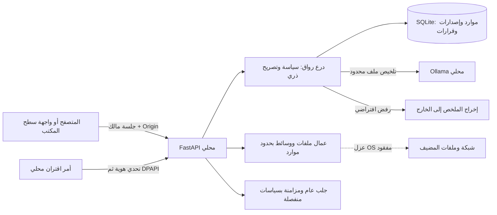

# قرار القبول الأمني قبل الذاكرة الشخصية

تاريخ الفحص: **15 نوفمبر 2026**. القرار: **BLOCKED — لا يُوصى بتفعيل المرحلة الثامنة أو إطلاق النطاق المتأثر ببيانات شخصية حقيقية**. أُنجزت تقوية قابلة للتشغيل والمراجعة وعزل OS جزئي محدد أدناه، لكن العزل وتغطية سياسة البيانات والتفويض ليست شاملة لكل الوحدات، والمراجعة الأمنية البشرية المستقلة لم تحدث. نجاح الاختبارات التالية لا يرفع هذه العوائق.

## تحديث الاستكمال بعد الجولة الأمنية الأصلية

SG-07/G-N1 عولجا جزئيًا لمحولات Python/Node والمحللات القديمة والعامة، ثم لفحص ومعالجة صفحات PDFium وOCR وOffice. [قبول المستندات الحديث](../reports/document-isolation-validation.json) و[مسار الواجهة الحقيقي](../reports/completion-documents-ui/2026-11-15T19-20-40.684Z/report.json) منفصلان عن اختبارات المحاكاة. نُقل أيضًا replay التاريخي في أدوات إعادة المعالجة/تقييم originals إلى الحاوية واختُبر؛ [الدليل](../reports/resume-public-replay-live/report.json). لا تغلق هذه النتائج SG-07 لجميع العمال: قص منطقة الفهم البصري وعمال الوسائط وسياسات المخارج والمشتقات ليست مشمولة. اكتملت دورة إغلاق وإعادة فتح الحزمة السابقة وتنظيف أبنائها؛ تفاعل المحادثة داخل WebView والمراجعة الأمنية البشرية المستقلة ما زالا غير متحققين. الجداول التاريخية أدناه لا تتجاوز هذا التحديث أو ترفع بوابة الذاكرة.

هذا هو مرجع نتائج هذه الجولة. التصميم والتشغيل في [درع رواق](RIWAQ_GUARD.md)، ونموذج التهديد ومصفوفة ASVS في [الأمن](RIWAQ_SECURITY.md). التكليف الأمني الأحدث G يقدّم حماية البيانات على تفعيل الذاكرة أو السحابة، دون تغيير اسم المنتج أو بدء تدريب/تنزيل نماذج. لا شهادة امتثال أو وعد بمنع الاختراق.

## النطاق والنسخة

فُحص المصدر المحلي للواجهة والخدمة وSQLite والمزامنة الاختيارية والعمال، على Windows 11 / Python 3.12.10 / Chrome / React وTypeScript. الجهاز: RAM نحو31.84GiB وRTX5060 بذاكرة8151MiB. الخدمة تربط `127.0.0.1:8765`، وOllama محلي على11434. لا نشر عام أو اتصال مدفوع أو هجوم على طرف ثالث. التطبيق المحلي **مالك OS واحد**؛ حسابا المزامنة ليسا حسابين محليين داخل التطبيق.

لا يوجد مستودع Git في مساحة العمل، لذلك لم يُنشأ commit أو فرع مصطنع. نقطة الرجوع السابقة في `D:/RiwaqBuild/backups/guard-v1-2026-11-15` تضم381 ملف مصدر ونسخة SQLite متسقة. [manifest الأساس](../reports/guard-baseline-manifest.json) و[manifest الحالة النهائية](../reports/guard-final-manifest.json) يحددان الملفات وبصماتها. لم تُحذف أعمال سابقة. ملفات الاختبار الحي اصطناعية في مجلد منفصل؛ فحص الترحيل استخدم نسخة خاصة غير متصلة من قاعدة العمل ولم يطبع محتواها.

## العيوب والقرار المتخذ

| المعرّف / الأثر | الدليل وإعادة الإنتاج الآمنة | الإصلاح أو الحالة المتبقية |
|---|---|---|
| SG-01 / P1 مثبت | عميل محلي بلا جلسة كان يستطيع قراءة API مع الترويسة العامة؛ قبل200 وبعد401 في `guard-latency.json` | اقتران صريح أحادي الاستخدام، DPAPI، جلسة خادمية، انتهاء وسحب وفحص أثناء البث. لا ادعاء بعزل برنامج خبيث بهوية OS نفسها |
| SG-02 / P1 نقص ضبط مثبت | لم يوجد تصريح خاص يربط الملف والوجهة والمعلمات ونسخة الإذن ويُستهلك ذريًا | نُفّذ لمسار تلخيص الملف؛ اختبارات تبديل المعلمات/الجلسة/الوجهة وإعادة الاستخدام وعمليتين حقيقيتين. بقية المسارات تحتاج توسيعًا مراجَعًا |
| SG-03 / P1 سباق مثبت بالاختبار | اكتمال تسجيل دخول مزامنة قديم بعد الخروج أو دخول أحدث قد يعيد اعتمادًا قديمًا | epoch وtoken hash في SQLite وكتابة keyring متسلسلة؛ عشرة اختبارات بخدمة خارجية محاكية، لا اختبار حسابات سحابي حي |
| SG-04 / P1 حد موارد ناقص | رفع PDF/DOCX القديم كان يحلل داخل عملية الخدمة، فلا يكفي إلغاء طلب HTTP لإيقاف المحلل | نقل إلى عامل ثابت قابل للإنهاء،45ثانية/768MiB/عامل واحد، دون تنفيذ على المضيف كبديل عند فشله. ليس عزل OS |
| SG-05 / P2 كشف زائد في دليل القرار | أول اختبار Chrome رفض حقول هوية إضافية في الدليل | قائمة سماح من ستة حقول، واختبار المتصفح نجح بعد الإصلاح. فشل الجولة الأولى محفوظ |
| SG-06 / P2 أسطح خروج وحدود طلب | إعداد telemetry في FastAPI قابل للتأثر بالبيئة، وروابط نموذج قد تشير إلى خدمة محلية، وردود رفض مبكرة دون كل الرؤوس | تعطيل telemetry الاختيارية صراحة، وسياسة روابط HTTPS محدودة، ورؤوس مبكرة وSPA، ومهلة جسم الطلب وحصة مالك مشتركة. لا جدار خروج OS |
| SG-07 / P1 فجوة مثبتة ومفتوحة | `scripts/guard_probe.py worker-boundary`: عامل اختباري عبر المشرف الحالي اتصل بمستمع loopback مملوك وقرأ ملفًا اصطناعيًا خارج cwd | **لم تُحل**. يلزم AppContainer/VM أو عزل مناسب موثّق ومختبَر قبل قبول مصادر عدائية وذاكرة شخصية. تنفيذ شيفرة مشاريع المستخدم ما زال محظورًا |
| SG-08 / إصلاح اعتمادي موجّه مطبّق | أكد جرد Guard السابق وجود torch 2.7.1+cu128 وurllib3 2.5.0 في بيئتي التدريب والصور؛ وصول الاستغلال كان مشروطًا | **طُبّق التحديث وتُحقق منه لاحقًا في 15 نوفمبر 2026:** torch 2.10.0+cu128 وurllib3 2.8.0 في البيئتين النشطتين، وBrotli 1.2.1 في الصور. تفاصيل الدليل والحدود أدناه؛ لا إغلاق شامل للمخاطر أو رفع لحجب المرحلة 8 |
| SG-09 / بوابة حساسية | حفظ تفضيل شخصي جديد وحقنه في السياق قبل قبول الضوابط | الكتابة الجديدة محظورة423، والقديم مستبعد من سياق التوليد؛ القراءة والحذف محفوظان. ذاكرة المشروع اليدوية باقية ولا تعني قبول المرحلة8 |
| SG-10 / غير متحقق | حزمة سطح المكتب الأصلية والمصادقة متعددة المستخدمين وMFA ونشر HTTPS | تعديل المصدر ليس اختبار حزمة أو نشر. لا اعتماد لهذه النطاقات |
| SG-11 / خطر تخزين متبقٍ | SQLite والوسائط غير مشفرة عمومًا؛ نسخة DPAPI الجديدة تغطي SQLite فقط | ACL محلي وفحص نسخة مشفرة واستعادة محجورة. ليست حماية شاملة من OS، ولا secure erase أو استعادة كل الوسائط |

مطابقة SG-08 الأصلية موثقة في [جرد المكونات التاريخي قبل التحديث](../reports/guard-sbom.json). نشرة [PyTorch](https://github.com/pytorch/pytorch/security/advisories/GHSA-63cw-57p8-fm3p) تعالج تحميل checkpoint خبيث بـ`weights_only=True` وتحدد الإصلاح من 2.10.0. نشرتا [urllib3 الخاصة بـTLS proxy](https://github.com/urllib3/urllib3/security/advisories/GHSA-8988-9cw3-xx77) و[الاستجابة المتدفقة](https://github.com/urllib3/urllib3/security/advisories/GHSA-vxq7-64xx-v4gw) تحددان الإصلاح 2.8.0. هذه مراجعة موجّهة، لا مسح ثغرات شامل ولا إثبات استغلال رواق. خدمة المحادثة الأساسية لا تحتوي torch ضمن metadata التي فُحصت.

## تحديث SG-08 اللاحق: 15 نوفمبر 2026

تؤكد [نتائج التحقق](../reports/security-update-validation.json) و[سجل التثبيت والرجوع](../reports/security-update-installation.json) و[SBOM الجديد](../reports/security-update-sbom.json) تطبيق التحديث على مفسرَي التشغيل الفعليين، بعد نجاح فحص البيئتين المرشحتين:

| بيئة التشغيل النشطة | الإصدارات المثبتة | التحقق المحدد |
|---|---|---|
| `D:/RiwaqRuntime/training-v1/venv/Scripts/python.exe` | torch 2.10.0+cu128؛ urllib3 2.8.0؛ Brotli غير مثبت | فحص الاعتماديات، CUDA وcuDNN وSDPA، وbitsandbytes NF4 وsafetensors، وخطوة تدريب اصطناعية صغيرة بـPEFT مع الحفظ وإعادة التحميل |
| `D:/RiwaqRuntime/visual-v1/venv/Scripts/python.exe` | torch 2.10.0+cu128؛ urllib3 2.8.0؛ Brotli 1.2.1 | الفحوص السابقة، وقراءات Brotli محدودة، وتوليد صورة 512×512 عبر عامل الخادم ثم حفظها واسترجاعها في قاعدة اختبار اصطناعية |

نجح **65 اختبارًا، دون فشل أو تجاوز، في 26.367 ثانية** ضمن هذه الجولة المحددة. نجح كذلك استدلال Qwen الحقيقي على الأوزان المحلية القائمة في البيئة المرشحة؛ لم يُفعّل المحوّل التدريبي المرفوض أو تُغيّر الأوزان أو بيانات المستخدم. حُفظ فشل مهلة الفحص الأول عند 300 ثانية أثناء النسخ الاحتياطي، ثم نجحت الإعادة بعد انتهائه. رُفض Brotli 1.2.0 قبل اعتماده في البيئة النشطة بسبب التنبيه المسجل، واعتمد 1.2.1 بدلًا منه. لا نعد تجاوز فحص Brotli في بيئة التدريب نجاحًا؛ الحزمة غير مثبتة فيها.

فحص فصل سياق HTTPS proxy محاكى محليًا، وليس مصافحة TLS حقيقية أو اختبار استغلال. لا تشمل الأدلة تدريبًا طويلًا، أو استئناف checkpoint قديم، أو مسح ثغرات شاملًا، أو مراجعة أمنية بشرية مستقلة. لم يُعَد التحقق من واجهة المتصفح في نهاية الجولة؛ رفض `127.0.0.1:8765` اتصال HTTP في الفحص الأخير، ولم يُعِد التحديث تشغيل الخدمة أو يوقفها. نجاح العامل المباشر على بيانات اصطناعية مستقل عن صحة خدمة HTTP الحية.

تبقى نسخ الرجوع القديمة في `D:/RiwaqRuntime/security-updates-20261115/rollback`، وقد تتضمن الإصدارات المتأثرة. هذه مادة رجوع تاريخية، وليست بيئة التشغيل النشطة؛ لا تُفعّل تلقائيًا، ويستلزم استخدامها إعادة تقييم التنبيهات. جرد Guard ونتائج جولته أدناه محفوظان بتاريخها، ويصف SBOM الجديد بيئتي GPU بعد التحديث فقط. **الإصلاح الموجّه مطبّق، لكن قرار Stage8 يبقى BLOCKED**؛ لم يُنشأ عزل OS ولم تكتمل المراجعة المستقلة أو تغطية التفويض والتحقق الأصلي.

## نتائج التحقق في جولة Guard السابقة

- خط الأساس: **987 ناجحًا،1 متجاوزًا**،57.89ثانية. الانحدار النهائي: **1065 ناجحًا،1 متجاوزًا**،94.94ثانية في [JUnit](../reports/guard-pytest.xml). تجاوز symlink بسبب صلاحية Windows؛ فحص hardlink ناجح. لا نعد المتجاوز نجاحًا. بعد ذلك أضيفت8 اختبارات انحدار للعامل الثابت، ونجحت منفصلة في0.88ثانية دون تعديل كود التشغيل: [تقرير العامل](../reports/guard-worker-pytest.xml).
- بناء `tsc -b && vite build` نجح؛ تحذير حجم الحزمة الرئيسية نحو690KB باقٍ، وليس نتيجة أمنية. اختبارات الروابط:33 حالة URL و6 حالات عرض ReactMarkdown/SourceLink ناجحة. اختبار النقل في الواجهة منفصل ومحاكى.
- [Chrome الحقيقي](../reports/guard-ui/report.json):7 حالات و10 تخطيطات بعرض360/390/768/1280/1440، فاتح/داكن وعربية/إنجليزية؛ لا أخطاء صفحة أو طلبات خارجية رُصدت من المتصفح في هذا السيناريو. لا اختبار قارئ شاشة أو ميكروفون أو حزمة أصلية في هذه الجولة.
- المسار الحي استعمل `qwen3:4b-instruct` المحلي: اقتران حقيقي عبر CLI وتحدي الخدمة ← ملف اصطناعي ← تلخيص مكتمل ← حفظ واستعادة ← محاولة وجهة غير مخوّلة تُرفض403 عند نفس بوابة التنفيذ ← فتح سجل قرار محدود. لا عميل شبكة أُنشئ للوجهة المرفوضة، ولا نموذج محاكى في هذه الحالة. جودة التلخيص الدلالية العامة غير معتمدة.
- اختبار تصريح من عمليتين Python حقيقيتين أثبت مطالبة واحدة فقط؛ لا ادعاء بتنفيذ خارجي exactly-once. الحذف/سحب الجلسة/الإلغاء أثناء رد محاكى منع النشر المتأخر. أعطال مخزن السياسة/الحصة ومفتاح الهوية تفشل بالرفض.
- [الترحيل](../reports/guard-migration.json):51 جدولًا قديمًا بلا تغير في بصمات محتواها، و10 جداول جديدة، على نسخة غير متصلة. [نسخ واستعادة فعلية](../reports/guard-backup-drill.json): integrity_check ناجح، جلسات وتصاريح صفر بعد الاستعادة، وحجر إلزامي. لا استبدال لقاعدة العمل أو استعادة وسائط.
- [اختبار حدود العامل](../reports/guard-worker-boundary.json) **أثبت غياب العزل**؛ نتيجة مفيدة للتدقيق وليست نجاحًا للضابط. خرج العامل0 ولا عمليات متبقية. لم يُستغل محلل حقيقي ولم يحدث اتصال خارجي.
- [فحص الأسرار](../reports/guard-secret-scan.json) موجه بنمط محدود؛ وجد علامتين اصطناعيتين معروفتين في اختبار، دون نشر قيم. لا يثبت غياب كل سر. `pip check` تعذر لغياب pip في بيئة الخدمة؛ جرد metadata والملفات المقفلة ليس بديلًا كاملًا عنه.

الفشل الأول في اختبار المتصفح، وفشل اختباري parsing محاكاة بعد عزل السحابة، محفوظان. عولج الأول بتقليل بيانات الدليل، والثاني بفصل محلل الإطار الخالص عن استدعاء المزود؛ **لم يُرفع منع السحابة لإنجاح الاختبارات**. راجع [النتائج المجمعة](../reports/guard-validation.json) للتقارير الآلية النهائية.

## أثر الضوابط وحدوده

في50 طلبًا متتابعًا دافئًا لكل ذراع إلى `GET /api/projects` داخل TestClient، كان p50/p95 قبل التغيير2.65/2.94ms، وبعد الضوابط النهائية15.52/15.99ms. بقي50/50 طلبًا مخوّلًا ناجحًا؛ تحولت القراءة بلا جلسة من200 إلى401. القياس يشمل حصة SQLite النهائية؛ الذراع الوسيط محفوظ منفصلًا. لا تعميم إلى حمل متزامن أو كل أدوات التطبيق، ولا تقدير لمعدل المنع الخاطئ عبر جميع اللغات. [القياس وإعادته](../reports/guard-latency.json).

لا كلفة مزود مدفوعة أو استئجار أو تنزيل نموذج في جولة Guard السابقة؛ استدلال محلي وقراءة مراجع أمنية عامة فقط. لم تُقَس كلفة الكهرباء. زمن تقرير التلخيص يشمل الجدولة والحفظ وليس benchmark للنموذج. حصص الطلب600/دقيقة لكل مالك في SQLite، وإلغاء/خروج يبقيان متاحين عند بلوغها؛ لا حصة تخزين كلية أو مقاومة DoS على مستوى النظام.

## ما يلزم لرفع الحجب

1. **المهمة التالية G-N1:** تطبيق عزل Windows للعمال المختارين دون أسرار أو مجلدات عامة وبشبكة مغلقة؛ إعادة canary الحالي ويجب أن يُمنع مع بقاء PDF/OCR/التركيب المشروع صالحًا. عند عدم توفر العزل، يبقى نطاق المصادر العدائية غير معتمد.
2. **أُنجز الإصلاح الاعتمادي المحدد لـSG-08** في بيئتي الصور والتدريب، مع تحديث SBOM وملفات القفل والتحقق المبين أعلاه. تبقى مراجعة بقية الاعتماديات والمسارات وحدود التشغيل مطلوبة؛ النسخ القديمة للرجوع ليست مصححة، ونجاح هذه الجولة لا يغني عن عزل العمال أو المراجعة المستقلة.
3. تمديد سياسة البيانات وإصدارات الصلاحيات والتفويض إلى مخارج الوحدات الأخرى والمهام والمزامنة والاستعادة؛ اختبار إلغاء الوصول وحسابين حيث يوجد تعدد حسابات فعلي. لا تفعيل للسحابة بمجرد تغيير متغير بيئة.
4. مراجعة أمنية بشرية مستقلة للمصادقة والتصاريح والعزل والحذف والاستعادة، ثم اختبار الحزمة الأصلية/نشر HTTPS إن كان ضمن الاستخدام. لا توجد هذه المراجعة في مخرجات الوكلاء الحاليين.

خطوات عزل الجلسات والأداة والاستعادة في [دليل الاستجابة](RIWAQ_GUARD.md#أوامر-المشغل-والاستجابة-للحوادث). سجلات SQLite ليست غير قابلة للتلاعب من مدير OS؛ التنبيهات الخارجية وإدارة مفاتيح مستقلة والاستعادة الشاملة خارج الموقع غير منفذة. أي تغيير جوهري في الأدوات أو الوجهات أو الذاكرة أو الهوية أو النشر يستلزم إعادة تقييم هذه البوابة، لا إعادة استخدام نتيجة اليوم تلقائيًا.

إعادة التشغيل النهائية في جولة Guard السابقة على قاعدة العمل نجحت: تطابق تحدي هوية الخدمة، و401 للقراءة غير المقترنة، وبصمات جميع الجداول السابقة51 بقيت دون تغير. [الدليل الآمن التاريخي](../reports/guard-service-restart.json). رمز اقتران المستخدم لم يُصدر أو يُطبع تلقائيًا. هذه نتيجة تلك الجولة، ولا تصف حالة منفذ HTTP وقت التحديث الاعتمادي اللاحق.
